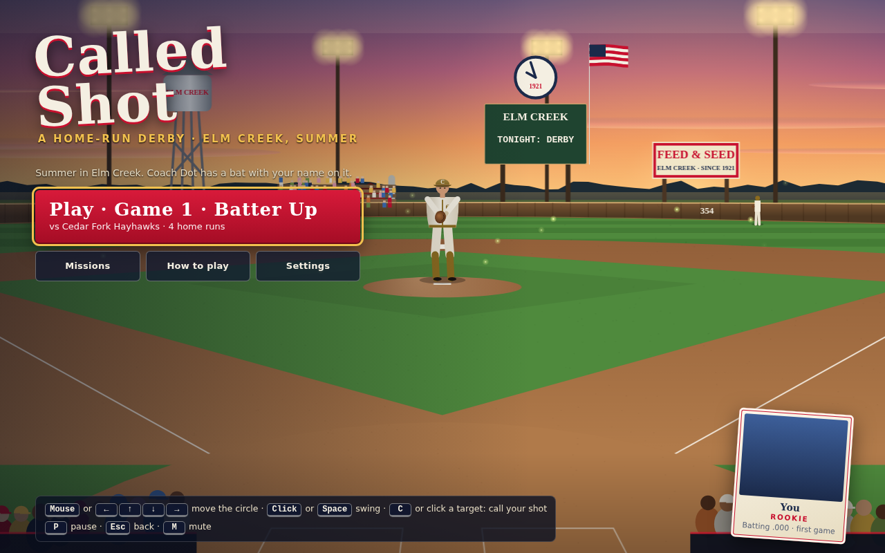
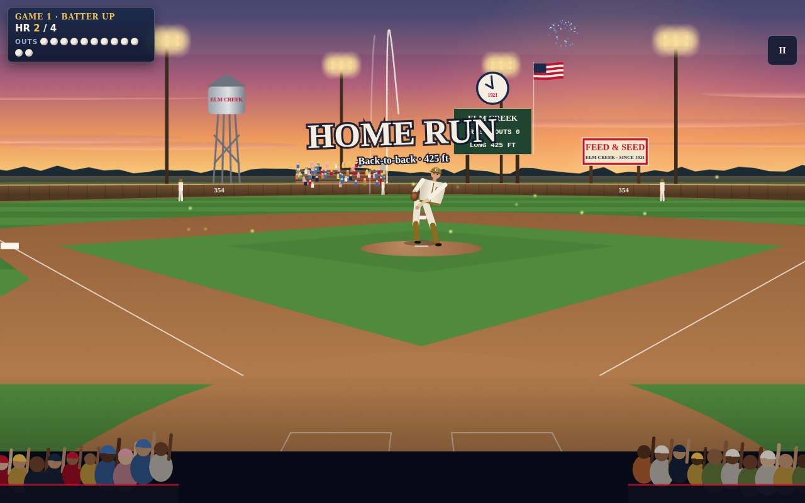

# Called Shot

**Time the pitch and swing for the fences in small-town America, and call your shot at the water tower before you hit it.**

<p align="center">
  
</p>

<p align="center">
  <a href="https://ai-llm-2030.github.io/TrueMarch_Games_Called_Shot/"><b>▶ Play Called Shot in your browser</b></a>
</p>

## Gameplay

<p align="center">
  
</p>

## Controls

| Keys | Action |
|---|---|
| Mouse or ← ↑ ↓ → | Move the aiming circle |
| Click or Space | Swing |
| C or click a target | Call your shot |
| P | Pause |
| Esc | Back |
| M | Mute |

## Run it yourself

No install, no build step, no server code, no network. The game runs entirely in your browser and keeps your progress in the browser's local storage.

```bash
git clone https://github.com/ai-llm-2030/TrueMarch_Games_Called_Shot.git
cd TrueMarch_Games_Called_Shot
python3 -m http.server 8000
# open http://localhost:8000
```

Opening `index.html` directly works too in most browsers; a local server is the most reliable way.

## What's inside

```
TrueMarch_Games_Called_Shot/
├── index.html        the whole game: one file, plain JavaScript and <canvas>
├── assets/           the pictures in this README
├── LICENSE
└── README.md
```

Written from scratch in vanilla JavaScript: every sprite, background and sound is drawn or synthesised in code (Canvas 2D and the Web Audio API). No libraries, no frameworks, no third-party assets.

## About

**Called Shot** is one of the 120+ games made by **[TrueMarch](https://truemarch.com)**. This repository is the standalone single-player edition of the game.

## License

© 2026 TrueMarch. All rights reserved. The source is published so you can read it, learn from it and play the game; see [LICENSE](LICENSE).
